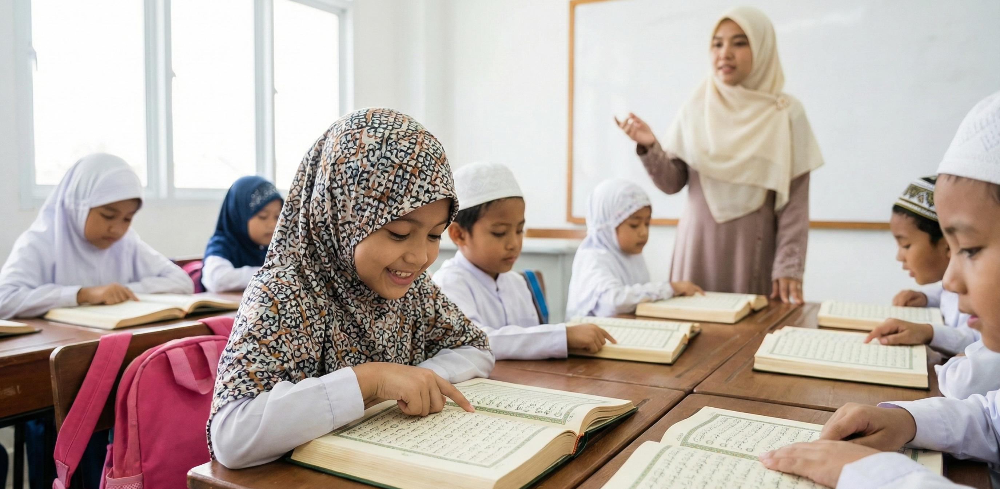
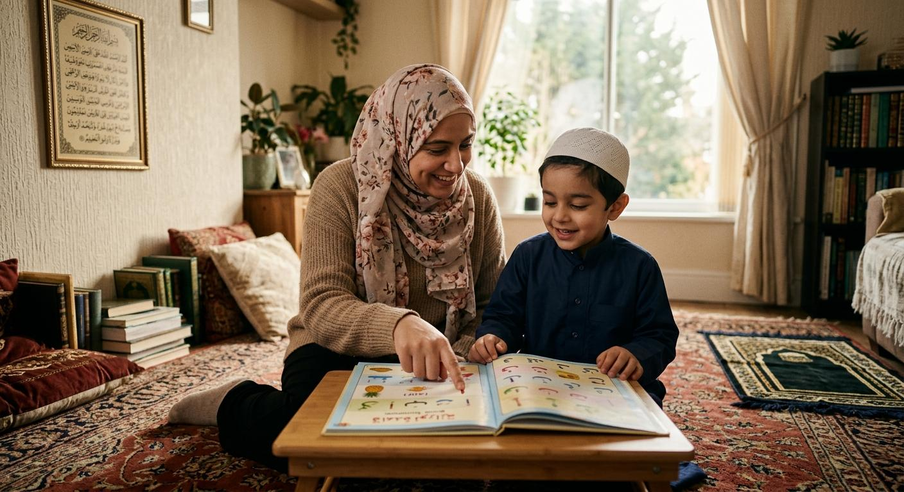
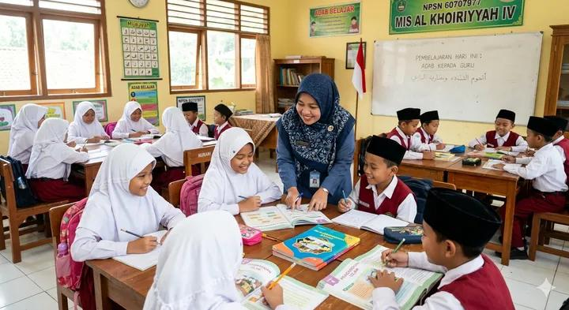
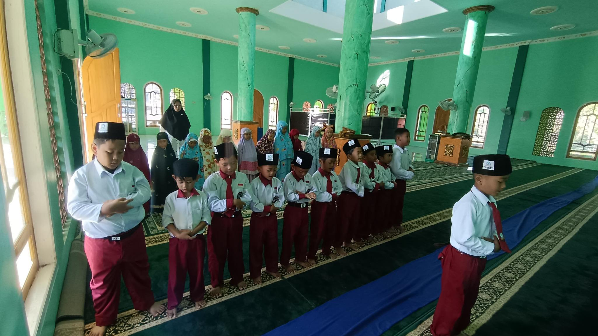

Perkembangan teknologi digital pada era modern saat ini telah membawa perubahan besar dalam kehidupan manusia, termasuk dalam dunia pendidikan dan pola pengasuhan anak. Kehadiran internet, media sosial, permainan digital, dan berbagai platform informasi memberikan kemudahan bagi anak-anak untuk memperoleh pengetahuan. Namun, di balik berbagai kemudahan tersebut, terdapat tantangan yang perlu mendapat perhatian serius, terutama dalam membentuk karakter dan moral generasi muda.

Salah satu hal penting yang perlu ditanamkan kepada anak sejak usia dini adalah pendidikan agama. Pendidikan agama bukan hanya mengajarkan anak untuk mengenal Tuhan dan menjalankan ibadah, tetapi juga membentuk kepribadian, akhlak, moral, serta perilaku yang baik dalam kehidupan sehari-hari.

Di tengah derasnya arus informasi digital, pendidikan agama menjadi salah satu fondasi penting agar anak mampu membedakan perilaku yang baik dan buruk serta menggunakan teknologi secara bijak dan bertanggung jawab.

## 1. Pendidikan Agama sebagai Fondasi Pembentukan Karakter Anak

Pendidikan agama sejak dini memiliki peran penting dalam membentuk karakter dan kepribadian anak. Masa kanak-kanak merupakan periode ketika anak mudah menyerap informasi dan meniru perilaku orang-orang di sekitarnya.

Melalui pendidikan agama, anak dapat diajarkan nilai-nilai kejujuran, kedisiplinan, tanggung jawab, kesabaran, kasih sayang, saling menghormati, dan kepedulian terhadap sesama.

Nilai-nilai tersebut menjadi bekal bagi anak dalam menghadapi berbagai persoalan kehidupan. Anak yang mendapatkan pendidikan agama dengan baik diharapkan memiliki pedoman moral yang kuat sehingga tidak mudah terpengaruh oleh perilaku negatif di lingkungan sekitarnya.

## 2. Tantangan Pendidikan Anak di Era Digital

Era digital memberikan banyak manfaat bagi perkembangan anak, seperti kemudahan mengakses informasi, belajar secara interaktif, dan mengembangkan kreativitas. Akan tetapi, penggunaan teknologi tanpa pengawasan juga dapat menimbulkan berbagai dampak negatif.

Beberapa tantangan yang dihadapi anak di era digital antara lain:

- Paparan konten negatif: Anak berpotensi melihat tayangan yang tidak sesuai dengan usia dan perkembangan moralnya.
- Kecanduan gadget: Penggunaan perangkat digital secara berlebihan dapat mengurangi waktu belajar, bermain, beribadah, dan berinteraksi dengan keluarga.
- Menurunnya interaksi sosial: Anak dapat lebih banyak menghabiskan waktu di dunia maya daripada berkomunikasi secara langsung.
- Pengaruh media sosial: Anak dapat meniru gaya hidup, bahasa, maupun perilaku yang belum tentu sesuai dengan nilai-nilai agama dan budaya.
- Lemahnya pengawasan: Kemudahan mengakses internet membuat anak membutuhkan pendampingan dari orang tua dan pendidik.

Oleh karena itu, pendidikan agama sangat diperlukan sebagai pedoman agar anak mampu menghadapi berbagai tantangan tersebut.

## 3. Menanamkan Nilai-Nilai Agama Sejak Usia Dini

Pendidikan agama sebaiknya tidak hanya diberikan melalui teori atau nasihat, tetapi juga melalui pembiasaan dalam kehidupan sehari-hari.

Beberapa cara yang dapat dilakukan orang tua dan pendidik antara lain:

1. Mengenalkan Tuhan sejak dini. Mengajarkan anak untuk mengenal dan bersyukur atas ciptaan Tuhan.
2. Membiasakan beribadah. Mengajak anak berdoa, membaca kitab suci, dan menjalankan ibadah sesuai ajaran agama.
3. Mengajarkan akhlak yang baik. Membiasakan anak berkata jujur, menghormati orang tua, menyayangi teman, dan membantu sesama.
4. Memberikan teladan. Orang tua dan guru harus menjadi contoh nyata dalam menerapkan nilai-nilai agama.
5. Membiasakan perilaku positif. Mengajarkan anak untuk bersikap sopan, bertanggung jawab, dan menghargai perbedaan.

Pembiasaan yang dilakukan secara konsisten akan membantu nilai-nilai agama tumbuh menjadi bagian dari kepribadian anak.

## 4. Peran Orang Tua dan Guru dalam Pendidikan Agama di Era Digital

Keberhasilan pendidikan agama tidak hanya menjadi tanggung jawab lembaga pendidikan, tetapi juga membutuhkan keterlibatan aktif orang tua dan lingkungan masyarakat.

Peran orang tua sangat penting karena keluarga merupakan lingkungan pendidikan pertama bagi anak. Orang tua perlu memberikan contoh perilaku yang baik, mendampingi penggunaan gadget, membatasi waktu layar, serta membangun komunikasi yang terbuka dengan anak.

Sementara itu, guru memiliki tanggung jawab untuk menyampaikan pendidikan agama secara menarik, kreatif, dan sesuai dengan perkembangan zaman. Guru dapat memanfaatkan media digital sebagai sarana pembelajaran, seperti video edukasi keagamaan, aplikasi belajar membaca Al-Qur'an, dan cerita-cerita inspiratif yang mengandung pesan moral.

Kerja sama antara orang tua dan guru akan menciptakan lingkungan pendidikan yang mendukung perkembangan spiritual, emosional, dan sosial anak.

## 5. Memanfaatkan Teknologi Digital sebagai Sarana Pendidikan Agama

Teknologi digital sebenarnya tidak selalu memberikan dampak negatif. Jika digunakan secara tepat, teknologi justru dapat menjadi sarana yang efektif untuk mendukung pendidikan agama.

Beberapa pemanfaatan teknologi digital dalam pendidikan agama antara lain:

- Menggunakan aplikasi belajar membaca Al-Qur'an.
- Menonton video kisah nabi dan tokoh-tokoh teladan.
- Mendengarkan ceramah atau lagu-lagu religi yang sesuai dengan usia anak.
- Mengakses konten edukasi tentang akhlak dan moral.
- Mengikuti pembelajaran agama secara daring dengan pendampingan orang tua.

Dengan demikian, anak tidak hanya menjadi pengguna teknologi, tetapi juga mampu memanfaatkan teknologi untuk memperoleh pengetahuan dan meningkatkan pemahaman agamanya.

## 6. Membangun Generasi yang Beriman, Berakhlak, dan Cerdas Digital

Tujuan utama pendidikan agama sejak dini bukan sekadar menjadikan anak pandai membaca kitab suci atau memahami aturan ibadah, melainkan membentuk generasi yang memiliki keseimbangan antara kecerdasan intelektual, emosional, dan spiritual.

Anak perlu dibekali kemampuan untuk menggunakan teknologi secara bijak, menjaga etika ketika berkomunikasi di media sosial, menghargai orang lain, serta bertanggung jawab atas setiap tindakan yang dilakukan, baik di dunia nyata maupun dunia digital.

Dengan bekal pendidikan agama yang kuat, diharapkan anak mampu menghadapi perubahan zaman tanpa kehilangan jati diri, nilai moral, dan prinsip kehidupan yang baik.

## Penutup

Pendidikan agama sejak dini merupakan investasi penting dalam membangun generasi masa depan yang beriman, berakhlak mulia, dan memiliki karakter yang kuat. Di tengah perkembangan teknologi digital yang semakin pesat, anak tidak cukup hanya dibekali kemampuan akademik dan keterampilan menggunakan teknologi, tetapi juga harus memiliki landasan moral dan spiritual yang kokoh.

Orang tua, guru, dan masyarakat memiliki tanggung jawab bersama untuk menanamkan nilai-nilai agama melalui pendidikan, keteladanan, dan pembiasaan dalam kehidupan sehari-hari.

Teknologi seharusnya tidak menjadi penghalang bagi pendidikan agama, melainkan dapat dimanfaatkan sebagai sarana untuk memperkuat pembelajaran. Dengan pendidikan agama yang ditanamkan sejak dini, kita dapat berharap lahir generasi yang tidak hanya cerdas dalam teknologi, tetapi juga bijaksana dalam bersikap, santun dalam bertutur kata, dan memiliki akhlak yang mulia.

Karena anak yang cerdas adalah harapan masa depan, tetapi anak yang cerdas, beriman, dan berakhlak mulia adalah investasi terbaik bagi peradaban bangsa.
