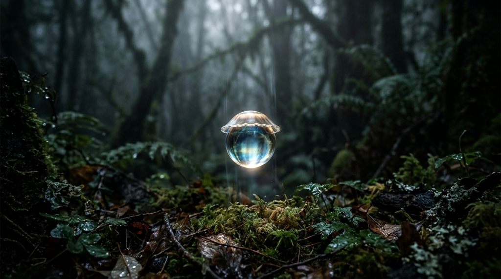
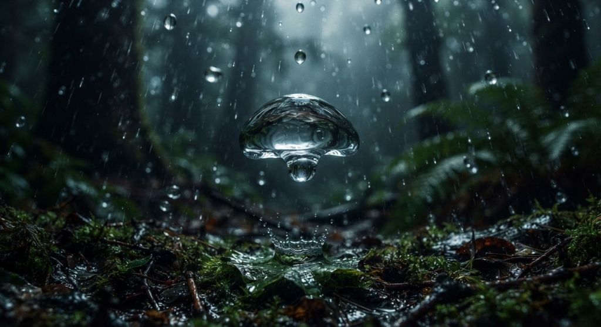
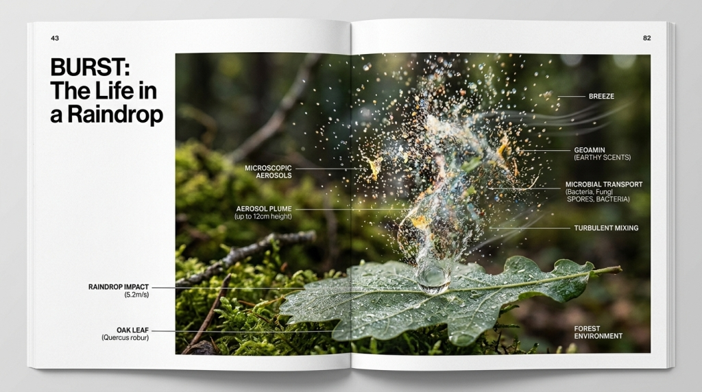
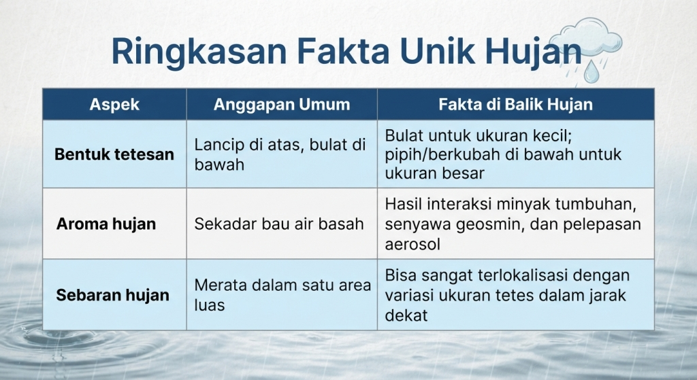

# Rahasia Hujan yang Jarang Diketahui: Di Balik Setiap Tetes yang Jatuh ke Bumi
Hujan sering kita anggap sebagai rutinitas alam yang biasa—sekadar air yang turun dari awan untuk membasahi bumi. Namun, jika kita menengok lebih dekat ke dunia fisika, kimia, dan ekologi di balik setiap tetesnya, hujan menyimpan banyak kejutan yang jarang disadari.

# Tetes Hujan Tidak Berbentuk Seperti Air Mata (Teardrop)

Banyak ilustrasi menggambarkan tetesan hujan dengan bagian atas meruncing dan bagian bawah membulat. Faktanya, tetesan hujan berukuran kecil cenderung berbentuk bulat seperti bola karena tegangan permukaan air menarik molekul-molekulnya agar saling mendekat.

Sementara itu, tetesan yang lebih besar mengalami tekanan udara dari bawah saat jatuh sehingga bagian bawahnya menjadi agak rata atau menyerupai kubah/roti burger sebelum akhirnya pecah menjadi tetesan yang lebih kecil.

# Aroma Khas Hujan adalah "Pesan Kimia" dari Alam

Wangi segar dan bersahaja saat hujan mulai turun dikenal sebagai petrichor. Aroma ini muncul dari perpaduan minyak yang dilepaskan tumbuhan saat cuaca kering serta senyawa kimia bernama geosmin yang dihasilkan oleh bakteri tanah (actinomycetes).

Menariknya, indra penciuman manusia sangat peka terhadap geosmin—bahkan pada konsentrasi yang sangat kecil sekalipun. Bagi sebagian hewan seperti unta atau satwa liar, aroma ini menjadi petunjuk alami menuju sumber air.

# Tidak Semua Tetes Hujan Berasal dari Awan yang Sama

Di dalam awan, butiran air dan kristal es saling bertumbukan, menyatu, lalu jatuh ketika bobotnya tidak lagi mampu ditopang arus udara ke atas. Namun, dalam perjalanan menuju permukaan bumi, tetesan hujan dapat menguap sebagian, bergabung dengan tetesan lain, atau terbawa angin melintasi batas suhu dan kelembapan yang berbeda.

Akibatnya, ukuran dan kepadatan hujan bisa berubah drastis bahkan dalam jarak beberapa ratus meter saja.

# Hujan Membawa "Penumpang" Mikroskopis ke Udara

Ketika tetesan hujan menghantam permukaan berpori seperti tanah atau daun, benturan kecil dapat menjebak gelembung udara mikroskopis lalu meletup dan melontarkan aerosol halus ke udara.

Proses ini membantu menyebarkan senyawa aromatik dan partikel mikroskopis dari tanah ke lapisan udara di dekat permukaan, sekaligus menjadi salah satu alasan mengapa udara terasa "berbeda" saat hujan turun.

  
Apakah ada fakta tertentu tentang hujan seperti pelangi, petir, atau siklus awan yang ingin Anda bahas lebih dalam?
